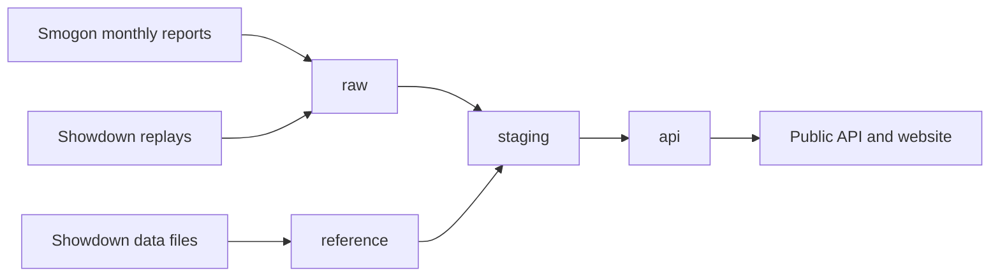
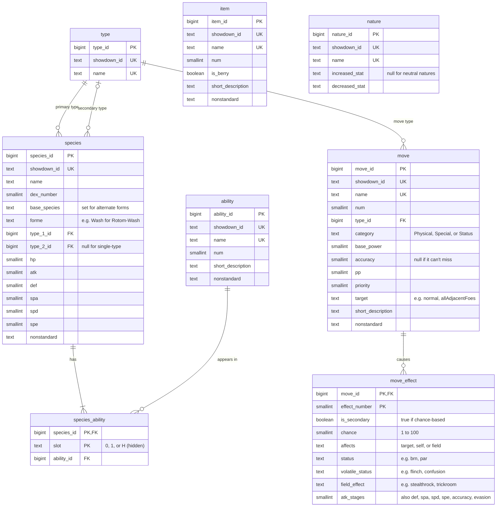
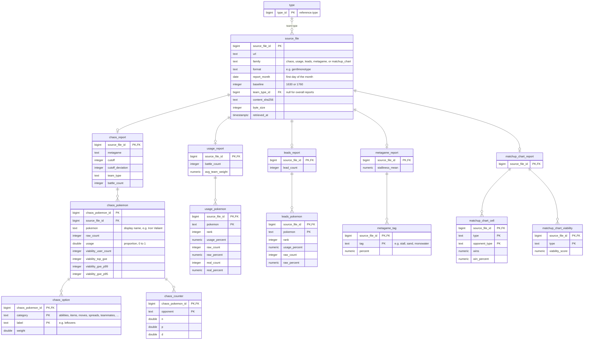
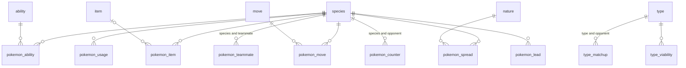

# Database Architecture

Showdown Analytics stores competitive Pokémon data in PostgreSQL: reference data and public battle replays from Pokémon Showdown, and monthly usage statistics from Smogon. This page describes the database and its tables.

## Database

| Setting | Value |
| --- | --- |
| Provider | DigitalOcean Managed Databases |
| Engine | PostgreSQL 18 |
| Database | `showdown-database` |
| Connections | Private network only, from trusted sources; TLS required |

## Schemas

Data moves through layers. Source data is stored as published, then cleaned and published for the API:

| Schema | Status | Contents |
| --- | --- | --- |
| `reference` | Deployed | Pokémon, types, abilities, moves, items, and natures from Showdown |
| `raw` | Deployed | Smogon's monthly reports and Showdown's replays as published |
| `staging` | Deployed | Cleaned report data with names matched to `reference` |
| `api` | Deployed | The published statistics; the only schema the API reads |
| `research` | Planned (M5) | Private team and battle records, never exposed publicly |

## Reference Data

The `reference` schema holds Pokémon Showdown's own data. Every table has a `showdown_id`, Showdown's lowercase identifier (e.g. `heavydutyboots` for Heavy-Duty Boots), alongside the display name. Entries that are no longer legal or not from Gen 9 are kept and flagged in `nonstandard` (e.g. `Past`, `CAP`).

| Table | Rows | Contents |
| --- | ---: | --- |
| `type` | 18 | The standard types; the Tera-only Stellar type is excluded |
| `species` | 1,462 | Species and battle-relevant forms; cosmetic forms are excluded |
| `ability` | 321 | Abilities with short descriptions |
| `species_ability` | 3,191 | Each species' abilities by slot |
| `move` | 954 | Moves with type, category, power, accuracy, and target |
| `move_effect` | 440 | Guaranteed and chance-based effects: statuses, stat stages, and field effects |
| `item` | 587 | Items with a berry flag and short descriptions |
| `nature` | 25 | Natures and the stats they raise and lower |

## Smogon Reports

Smogon publishes usage statistics each month as static files. Each file covers one format (here, Gen 9 Monotype), one weighting baseline, and either all teams (overall) or the teams of one type. The baseline weights each team by how likely its player's rating is above that number: 1630 reflects good players, and 1760 strong players, with less data behind it.

| Report family | Contents |
| --- | --- |
| Chaos | Per Pokémon: abilities, items, moves, EV spreads, teammates, checks and counters |
| Usage | Per Pokémon: weighted usage, team appearances, and appearances in battle |
| Leads | How often each Pokémon is sent out first |
| Metagame | Share of teams by type, play style, weather, and strategy; average stalliness |
| Matchup chart | Type-versus-type wins and win rates, and Smogon's type viability scores (overall only) |

The `raw` schema stores these reports as published, keeping Smogon's labels and printed precision. Each file is recorded once in `source_file`, and every other row traces back to it. If Smogon republishes a file with different content, it is stored as a new `source_file`, even when it reverts to an earlier version, and `staging` uses the latest one.

Row counts below are for September 2026.

| Table | Rows | Contents |
| --- | ---: | --- |
| `source_file` | 154 | 38 files each for chaos, usage, leads, and metagame (overall and 18 types at two baselines); 2 matchup charts |
| `chaos_report` | 38 | Each chaos file's header: format, baseline, team type, and battle count |
| `chaos_pokemon` | 1,862 | Usage and viability ceiling per Pokémon; both baselines omit Pokémon under 0.01% weighted usage |
| `chaos_option` | 284,261 | Weighted abilities, items, moves, spreads, teammates, Tera types, and happiness |
| `chaos_counter` | 2,710 | Checks and counters; only overall reports include them |
| `usage_report` | 38 | Battle count and average weight per team; per-type reports divide by all teams in the format |
| `usage_pokemon` | 2,892 | Rank and usage per Pokémon; real percent is scaled to sum to 600% (six team slots), so it can exceed 100% |
| `leads_report` | 38 | Total leads (two per battle), counted across all teams even in per-type reports |
| `leads_pokemon` | 2,550 | Lead rank and usage per Pokémon |
| `metagame_report` | 38 | Average stalliness: negative means more offensive teams, positive more defensive |
| `metagame_tag` | 694 | Share of teams with each tag; a team can have several tags, so shares sum to over 100% |
| `matchup_chart_report` | 2 | One chart per baseline |
| `matchup_chart_cell` | 648 | Weighted wins and win percent for each of the 18 × 18 type pairings; mirror matches show 0% |
| `matchup_chart_viability` | 36 | Smogon's ViabilityScore per type, a published score rather than a win rate |

`ingestion_run` logs each load: when it started and finished, its status (`running`, `succeeded`, `partial` when some downloads failed, or `failed` with the error), and how many files it loaded, skipped, and failed. The run updates its own row as it goes, the only update the loader can make, so a run killed partway through stays `running` and shows how far it got.

## Replays

Public Gen 9 Monotype replays from Pokémon Showdown are stored in `raw` as published. They are a sample of battles players chose to upload, not the whole ladder, so they are kept apart from Smogon's statistics.

| Table | Contents |
| --- | --- |
| `replay` | One row per replay: its ID, format, players, published rating, upload time, and full battle log. Rows are never changed, so a replay its uploader later deletes is kept. |

`replay_collection_run` logs each collection run the same way `ingestion_run` logs Smogon loads: its status, and how many replays it loaded and failed to download.

## Published Statistics

The `staging` and `api` schemas are built with [dbt](https://www.getdbt.com/) from `raw` and `reference` after each monthly load. A scheduled job checks daily for the previous month, loads it once Smogon publishes it, and then runs the build:

- **`staging`** holds views that clean each raw table once: they keep only the latest version of each file, match Smogon's names to `reference` IDs, and flag placeholders such as empty move slots. Tests check that every name matches, nothing is duplicated, and every loaded month and baseline has all 77 files.
- **`api`** holds the published statistics as tables and the reference data as views. Each model has a contract that fixes its column names, types, and constraints, so a change in Smogon's data fails the build rather than changing what clients see.

`staging` is built and tested first, and `api` is rebuilt only if every staging test passes. Each `api` table's own tests run after that table is rebuilt, so when one fails, the table already holds the new data until the problem is fixed and the build is rerun.

Every `api` statistic shares the same conventions:

| Area | Convention |
| --- | --- |
| Scope | `format`, `report_month`, `baseline`, and `team_type`: the type's Showdown ID (e.g. `water`), or null for overall reports. Matchup charts are overall only and have no `team_type`. |
| Identity | Each entity has an ID, its Showdown ID, and its name, e.g. `species_id`, `species` (`ninetalesalola`), and `species_name` (Ninetales-Alola). |
| Proportions | Shares and rates run from 0 to 1 (Smogon prints percentages). Each column's description states its denominator. A weighted share of 0 means only players with no weight at that baseline (such as those with provisional ratings) used the option. |
| Provenance | Every row has a `source_file_id` (one per report family in `report`) that links to `source_file`. |

The diagram shows how the statistics join to the reference views; every table also links to `source_file`.

Row counts below are for September 2026.

| Table | Rows | Contents |
| --- | ---: | --- |
| `source_file` | 154 | The Smogon files behind the statistics, with their URLs, retrieval times, sizes, and SHA-256 hashes |
| `report` | 38 | One row per scope: battle count, average weight per team, average stalliness, and each family's file |
| `available_month` | 2 | One row per month and baseline, with its file count and latest retrieval time; the newest month is the latest data |
| `pokemon_usage` | 2,892 | Usage rank and shares of teams (weighted and unweighted), share of Pokémon brought into battle, and Smogon's viability ceiling |
| `pokemon_ability` | 3,831 | Share of each Pokémon's sets with each ability |
| `pokemon_item` | 32,630 | Share of sets holding each item, including sets with no item |
| `pokemon_move` | 62,235 | Share of sets with each move; shares sum to at most 4 (four move slots) |
| `pokemon_spread` | 97,565 | Share of sets with each nature and EV spread |
| `pokemon_teammate` | 82,986 | Share of a Pokémon's teams that include each teammate |
| `pokemon_counter` | 2,710 | Checks and counters (overall only): encounters, the rate of being KOed or forced out, and Smogon's ranking score |
| `pokemon_lead` | 2,550 | Share of leads, weighted and unweighted |
| `metagame_tag` | 694 | Share of teams with each tag; tags overlap, so shares sum to over 1 |
| `type_matchup` | 648 | Weighted wins and win rate for each type pairing; mirror matches have no win rate |
| `type_viability` | 36 | Smogon's ViabilityScore per type, with its rank |

The views `species`, `type`, `ability`, `item`, `move`, and `nature` publish the reference data with the same naming.

A few values differ from how Smogon prints them:

- **Real usage:** Smogon scales "Real %" so all Pokémon sum to 600%, which lets it exceed 100%. `real_share` divides by 600 instead, giving each Pokémon's share of all Pokémon brought into battle.
- **Mirror matches:** Smogon prints a type against itself as 0%. `win_rate` is null for these, since no real win rate exists.
- **Placeholders:** empty move slots and unfilled team slots are left out; sets with no held item are kept, with a null item.

## Data Conventions

These conventions apply across schemas:

| Area | Representation |
| --- | --- |
| Names and identity | Explicit schema names, singular `snake_case` tables, and `bigint` identity keys with matching foreign keys. Natural keys have uniqueness constraints. Showdown IDs, display names, and original labels remain available; forms have distinct identities. |
| Time and versions | Instants use `timestamptz` in UTC. Report months use the first day of the month. Battle, upload, and retrieval times are kept separate. |
| Metrics and scope | Statistics are scoped by month, format, baseline, and team type. Raw counts are integers; weights are fractional. Proportions have explicit denominators. Usage and moveset counts remain separate, as do replay results and ladder-wide statistics. |
| Missingness and provenance | Unknown values are `NULL`; a measured zero remains zero. Observations and inferences are kept distinct. Every statistic links to the source file it was loaded from. |
| Integrity | Foreign keys, required fields, uniqueness rules, and range checks enforce consistency, so a malformed source file is rejected rather than partly stored. |
